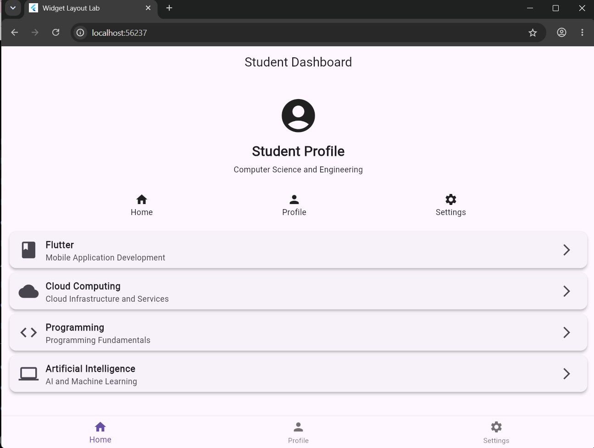

# Experiment 1: Working with Widgets and Layouts

**Course:** 24CS2016 Building Applications using Flutter  
**Student:** Santhosh V (URK23CS1003)  
**Date:** 24/08/26

## Aim
To develop a Flutter application using basic widgets and layout widgets such as Container, Row, Column, Expanded, Card, and ListView.

**Concepts:** Container, Column, Row, Expanded, Card, ListTile, ListView, Icon, BottomNavigationBar

## Quick run (using the files in this repo)

Platform folders (`android/`, `ios/`, `web/` ...) are not stored in the repo; generate them once:

```bash
cd experiment_1
flutter create --project-name experiment_1 .   # generates platform folders, keeps existing lib/ and pubspec.yaml
flutter pub get
flutter analyze      # expected: No issues found!
flutter test         # expected: All tests passed!
flutter run -d chrome
```

## Step-by-step procedure (from scratch)

**Step 1 - Check Flutter installation**

```bash
flutter doctor
flutter devices
```
`flutter devices` must list **Chrome** (or an emulator).

**Step 2 - Create the project**

```bash
flutter create --project-name experiment_1 experiment_1
cd experiment_1
code .
```

**Step 3 - Run the default app once (sanity check)**

```bash
flutter run -d chrome
```
Press `q` to quit.

**Step 4 - Open `lib/main.dart` and delete everything**

Replace it with the code in the **Complete code** section below (built up in this order: `MaterialApp` -> `Scaffold` + `AppBar` -> `Column`).

**Step 5 - Build the layout top to bottom inside `Column`**

1. `Container` with `Icon`, title and subtitle (profile header)
2. `Row` with `MainAxisAlignment.spaceEvenly` holding 3 small `Column`s (Home / Profile / Settings)
3. `Expanded` -> `ListView` -> 4 `Card` + `ListTile` items (Flutter, Cloud Computing, Programming, Artificial Intelligence)
4. `bottomNavigationBar: BottomNavigationBar` with 3 items

**Step 6 - Run and verify**

```bash
flutter run -d chrome
```

## Files

```text
experiment_1/
+-- lib/main.dart
+-- test/widget_test.dart
+-- pubspec.yaml
+-- output/   (screenshots)
```

## Complete code

### `lib/main.dart`
```dart
import 'package:flutter/material.dart';

void main() {
  runApp(const MyApp());
}

class MyApp extends StatelessWidget {
  const MyApp({super.key});

  @override
  Widget build(BuildContext context) {
    return MaterialApp(
      debugShowCheckedModeBanner: false,
      title: 'Widget Layout Lab',

      theme: ThemeData(primarySwatch: Colors.blue, useMaterial3: true),

      home: const StudentDashboard(),
    );
  }
}

class StudentDashboard extends StatelessWidget {
  const StudentDashboard({super.key});

  @override
  Widget build(BuildContext context) {
    return Scaffold(
      appBar: AppBar(title: const Text('Student Dashboard'), centerTitle: true),

      body: Column(
        children: [
          // ------------------------------------------------
          // CONTAINER
          // ------------------------------------------------
          Container(
            width: double.infinity,
            padding: const EdgeInsets.all(20),
            margin: const EdgeInsets.all(10),

            child: const Column(
              children: [
                Icon(Icons.account_circle, size: 70),

                SizedBox(height: 10),

                Text(
                  'Student Profile',
                  style: TextStyle(fontSize: 24, fontWeight: FontWeight.bold),
                ),

                SizedBox(height: 5),

                Text(
                  'Computer Science and Engineering',
                  textAlign: TextAlign.center,
                ),
              ],
            ),
          ),

          // ------------------------------------------------
          // ROW
          // ------------------------------------------------
          Row(
            mainAxisAlignment: MainAxisAlignment.spaceEvenly,
            children: const [
              Column(children: [Icon(Icons.home), Text('Home')]),

              Column(children: [Icon(Icons.person), Text('Profile')]),

              Column(children: [Icon(Icons.settings), Text('Settings')]),
            ],
          ),

          const SizedBox(height: 10),

          // ------------------------------------------------
          // EXPANDED
          // ------------------------------------------------
          Expanded(
            child: ListView(
              padding: const EdgeInsets.all(10),

              children: [
                // CARD 1
                Card(
                  elevation: 4,

                  child: ListTile(
                    leading: const Icon(Icons.book, size: 35),

                    title: const Text(
                      'Flutter',
                      style: TextStyle(fontWeight: FontWeight.bold),
                    ),

                    subtitle: const Text('Mobile Application Development'),

                    trailing: const Icon(Icons.arrow_forward_ios),
                  ),
                ),

                // CARD 2
                Card(
                  elevation: 4,

                  child: ListTile(
                    leading: const Icon(Icons.cloud, size: 35),

                    title: const Text(
                      'Cloud Computing',
                      style: TextStyle(fontWeight: FontWeight.bold),
                    ),

                    subtitle: const Text('Cloud Infrastructure and Services'),

                    trailing: const Icon(Icons.arrow_forward_ios),
                  ),
                ),

                // CARD 3
                Card(
                  elevation: 4,

                  child: ListTile(
                    leading: const Icon(Icons.code, size: 35),

                    title: const Text(
                      'Programming',
                      style: TextStyle(fontWeight: FontWeight.bold),
                    ),

                    subtitle: const Text('Programming Fundamentals'),

                    trailing: const Icon(Icons.arrow_forward_ios),
                  ),
                ),

                // CARD 4
                Card(
                  elevation: 4,

                  child: ListTile(
                    leading: const Icon(Icons.computer, size: 35),

                    title: const Text(
                      'Artificial Intelligence',
                      style: TextStyle(fontWeight: FontWeight.bold),
                    ),

                    subtitle: const Text('AI and Machine Learning'),

                    trailing: const Icon(Icons.arrow_forward_ios),
                  ),
                ),
              ],
            ),
          ),
        ],
      ),

      // ------------------------------------------------
      // BOTTOM NAVIGATION
      // ------------------------------------------------
      bottomNavigationBar: BottomNavigationBar(
        currentIndex: 0,

        items: const [
          BottomNavigationBarItem(icon: Icon(Icons.home), label: 'Home'),

          BottomNavigationBarItem(icon: Icon(Icons.person), label: 'Profile'),

          BottomNavigationBarItem(
            icon: Icon(Icons.settings),
            label: 'Settings',
          ),
        ],
      ),
    );
  }
}
```

### `test/widget_test.dart`
```dart
import 'package:flutter/material.dart';
import 'package:flutter_test/flutter_test.dart';

import 'package:experiment_1/main.dart';

void main() {
  testWidgets('Student dashboard renders widgets and layouts', (tester) async {
    tester.view.physicalSize = const Size(800, 1600);
    tester.view.devicePixelRatio = 1.0;
    addTearDown(tester.view.resetPhysicalSize);
    addTearDown(tester.view.resetDevicePixelRatio);

    await tester.pumpWidget(const MyApp());

    expect(find.text('Student Dashboard'), findsOneWidget);
    expect(find.text('Student Profile'), findsOneWidget);
    expect(find.text('Computer Science and Engineering'), findsOneWidget);
    expect(find.text('Flutter'), findsOneWidget);
    expect(find.text('Cloud Computing'), findsOneWidget);
    expect(find.byType(Card), findsNWidgets(4));
    expect(find.byType(BottomNavigationBar), findsOneWidget);
  });
}
```

### `pubspec.yaml`
```yaml
name: experiment_1
description: "A new Flutter project."
# The following line prevents the package from being accidentally published to
# pub.dev using `flutter pub publish`. This is preferred for private packages.
publish_to: 'none' # Remove this line if you wish to publish to pub.dev

# The following defines the version and build number for your application.
# A version number is three numbers separated by dots, like 1.2.43
# followed by an optional build number separated by a +.
# Both the version and the builder number may be overridden in flutter
# build by specifying --build-name and --build-number, respectively.
# In Android, build-name is used as versionName while build-number used as versionCode.
# Read more about Android versioning at https://developer.android.com/studio/publish/versioning
# In iOS, build-name is used as CFBundleShortVersionString while build-number is used as CFBundleVersion.
# Read more about iOS versioning at
# https://developer.apple.com/library/archive/documentation/General/Reference/InfoPlistKeyReference/Articles/CoreFoundationKeys.html
# In Windows, build-name is used as the major, minor, and patch parts
# of the product and file versions while build-number is used as the build suffix.
version: 1.0.0+1

environment:
  sdk: ^3.13.2

# Dependencies specify other packages that your package needs in order to work.
# To automatically upgrade your package dependencies to the latest versions
# consider running `flutter pub upgrade --major-versions`. Alternatively,
# dependencies can be manually updated by changing the version numbers below to
# the latest version available on pub.dev. To see which dependencies have newer
# versions available, run `flutter pub outdated`.
dependencies:
  flutter:
    sdk: flutter

  # The following adds the Cupertino Icons font to your application.
  # Use with the CupertinoIcons class for iOS style icons.
  cupertino_icons: ^1.0.8

dev_dependencies:
  flutter_test:
    sdk: flutter

  # The "flutter_lints" package below contains a set of recommended lints to
  # encourage good coding practices. The lint set provided by the package is
  # activated in the `analysis_options.yaml` file located at the root of your
  # package. See that file for information about deactivating specific lint
  # rules and activating additional ones.
  flutter_lints: ^6.0.0

# For information on the generic Dart part of this file, see the
# following page: https://dart.dev/tools/pub/pubspec

# The following section is specific to Flutter packages.
flutter:

  # The following line ensures that the Material Icons font is
  # included with your application, so that you can use the icons in
  # the material Icons class.
  uses-material-design: true

  # To add assets to your application, add an assets section, like this:
  # assets:
  #   - images/a_dot_burr.jpeg
  #   - images/a_dot_ham.jpeg

  # An image asset can refer to one or more resolution-specific "variants", see
  # https://flutter.dev/to/resolution-aware-images

  # For details regarding adding assets from package dependencies, see
  # https://flutter.dev/to/asset-from-package

  # To add custom fonts to your application, add a fonts section here,
  # in this "flutter" section. Each entry in this list should have a
  # "family" key with the font family name, and a "fonts" key with a
  # list giving the asset and other descriptors for the font. For
  # example:
  # fonts:
  #   - family: Schyler
  #     fonts:
  #       - asset: fonts/Schyler-Regular.ttf
  #       - asset: fonts/Schyler-Italic.ttf
  #         style: italic
  #   - family: Trajan Pro
  #     fonts:
  #       - asset: fonts/TrajanPro.ttf
  #       - asset: fonts/TrajanPro_Bold.ttf
  #         weight: 700
  #
  # For details regarding fonts from package dependencies,
  # see https://flutter.dev/to/font-from-package
```

## Expected output

**Student Dashboard (Chrome)**



The Chrome window shows the **Student Dashboard** screen:

- AppBar title: `Student Dashboard` (centered)
- Big account icon, bold `Student Profile`, and `Computer Science and Engineering`
- A row of three icons: **Home, Profile, Settings**
- Four elevated cards: **Flutter**, **Cloud Computing**, **Programming**, **Artificial Intelligence** (each with a leading icon, subtitle, and `>` arrow)
- Bottom navigation bar: Home (selected), Profile, Settings

## Result
A Flutter student profile/dashboard application was developed successfully. Basic widgets and layout widgets were used to organize the application interface. Containers, rows, columns, cards, icons, and list items were displayed effectively.
