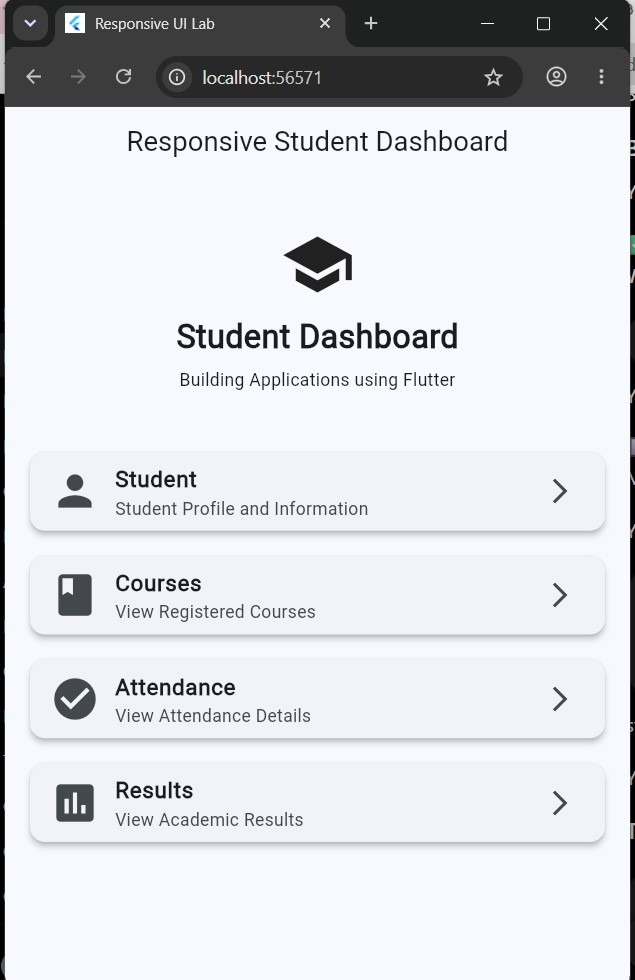
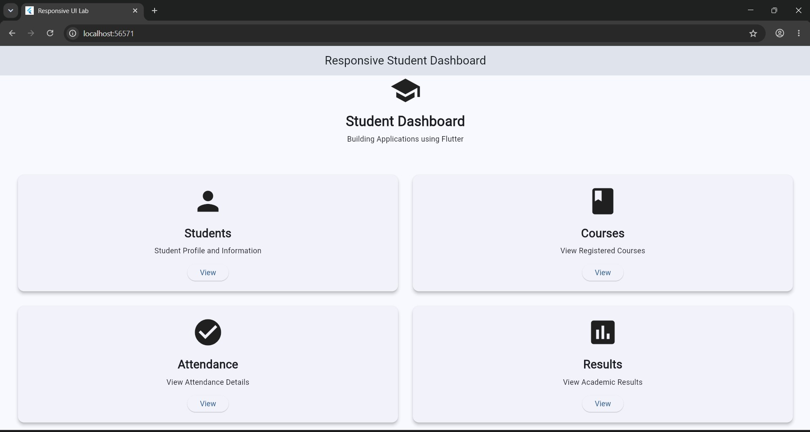

# Experiment 2: Adaptive and Responsive UI Design

**Course:** 24CS2016 Building Applications using Flutter  
**Student:** Santhosh V (URK23CS1003)  
**Date:** 24/08/26

## Aim
To create a Flutter application that automatically adapts its layout according to screen size.

**Concepts:** LayoutBuilder, BoxConstraints (`constraints.maxWidth`), Column vs Row, Expanded, Card, SingleChildScrollView

## Quick run (using the files in this repo)

Platform folders (`android/`, `ios/`, `web/` ...) are not stored in the repo; generate them once:

```bash
cd experiment_2
flutter create --project-name experiment_2 .   # generates platform folders, keeps existing lib/ and pubspec.yaml
flutter pub get
flutter analyze      # expected: No issues found!
flutter test         # expected: All tests passed!
flutter run -d chrome
```

## Step-by-step procedure (from scratch)

**Step 1 - Create the project**

```bash
flutter create --project-name experiment_2 experiment_2
cd experiment_2
code .
```

**Step 2 - Run once**

```bash
flutter run -d chrome
```

**Step 3 - Open `lib/main.dart`**

Delete the template code.

**Step 4 - Add `LayoutBuilder` in the Scaffold body**

```dart
LayoutBuilder(
  builder: (context, constraints) {
    if (constraints.maxWidth < 600) {
      return _buildMobileLayout();
    }
    return _buildDesktopLayout();
  },
)
```
Breakpoint = **600 px**.

**Step 5 - Mobile layout (< 600 px)**

`Column` of 4 `Card` + `ListTile` entries: Student, Courses, Attendance, Results.

**Step 6 - Desktop / tablet layout (>= 600 px)**

Two `Row`s, each with two `Expanded` cards (Students, Courses / Attendance, Results). Every card has an icon, text and a `View` button.

**Step 7 - Test both layouts**

Run in Chrome and **drag the browser window narrower/wider than 600 px** (or use DevTools device toolbar `Ctrl+Shift+M`).

## Files

```text
experiment_2/
+-- lib/main.dart
+-- test/widget_test.dart
+-- pubspec.yaml
+-- output/   (screenshots)
```

## Complete code

### `lib/main.dart`
```dart
import 'package:flutter/material.dart';

void main() {
  runApp(const MyApp());
}

class MyApp extends StatelessWidget {
  const MyApp({super.key});

  @override
  Widget build(BuildContext context) {
    return MaterialApp(
      debugShowCheckedModeBanner: false,
      title: 'Responsive UI Lab',

      theme: ThemeData(useMaterial3: true, colorSchemeSeed: Colors.blue),

      home: const ResponsiveHomePage(),
    );
  }
}

class ResponsiveHomePage extends StatelessWidget {
  const ResponsiveHomePage({super.key});

  @override
  Widget build(BuildContext context) {
    return Scaffold(
      appBar: AppBar(
        title: const Text('Responsive Student Dashboard'),
        centerTitle: true,
      ),

      body: LayoutBuilder(
        builder: (context, constraints) {
          // ------------------------------------------
          // MOBILE LAYOUT
          // ------------------------------------------
          if (constraints.maxWidth < 600) {
            return _buildMobileLayout();
          }

          // ------------------------------------------
          // DESKTOP / TABLET LAYOUT
          // ------------------------------------------
          return _buildDesktopLayout();
        },
      ),
    );
  }

  // ==================================================
  // MOBILE LAYOUT
  // ==================================================

  Widget _buildMobileLayout() {
    return SingleChildScrollView(
      padding: const EdgeInsets.all(16),

      child: Column(
        crossAxisAlignment: CrossAxisAlignment.stretch,

        children: [
          // Header
          _buildHeader(),

          const SizedBox(height: 20),

          // Student Card
          Card(
            elevation: 4,

            child: ListTile(
              leading: const Icon(Icons.person, size: 40),

              title: const Text(
                'Student',
                style: TextStyle(fontSize: 18, fontWeight: FontWeight.bold),
              ),

              subtitle: const Text('Student Profile and Information'),

              trailing: const Icon(Icons.arrow_forward_ios),
            ),
          ),

          const SizedBox(height: 12),

          // Courses Card
          Card(
            elevation: 4,

            child: ListTile(
              leading: const Icon(Icons.book, size: 40),

              title: const Text(
                'Courses',
                style: TextStyle(fontSize: 18, fontWeight: FontWeight.bold),
              ),

              subtitle: const Text('View Registered Courses'),

              trailing: const Icon(Icons.arrow_forward_ios),
            ),
          ),

          const SizedBox(height: 12),

          // Attendance Card
          Card(
            elevation: 4,

            child: ListTile(
              leading: const Icon(Icons.check_circle, size: 40),

              title: const Text(
                'Attendance',
                style: TextStyle(fontSize: 18, fontWeight: FontWeight.bold),
              ),

              subtitle: const Text('View Attendance Details'),

              trailing: const Icon(Icons.arrow_forward_ios),
            ),
          ),

          const SizedBox(height: 12),

          // Results Card
          Card(
            elevation: 4,

            child: ListTile(
              leading: const Icon(Icons.assessment, size: 40),

              title: const Text(
                'Results',
                style: TextStyle(fontSize: 18, fontWeight: FontWeight.bold),
              ),

              subtitle: const Text('View Academic Results'),

              trailing: const Icon(Icons.arrow_forward_ios),
            ),
          ),
        ],
      ),
    );
  }

  // ==================================================
  // DESKTOP / TABLET LAYOUT
  // ==================================================

  Widget _buildDesktopLayout() {
    return SingleChildScrollView(
      padding: const EdgeInsets.all(30),

      child: Column(
        children: [
          // Header
          _buildHeader(),

          const SizedBox(height: 30),

          // First Row
          Row(
            children: [
              Expanded(
                child: _buildDashboardCard(
                  icon: Icons.person,
                  title: 'Students',
                  subtitle: 'Student Profile and Information',
                ),
              ),

              const SizedBox(width: 20),

              Expanded(
                child: _buildDashboardCard(
                  icon: Icons.book,
                  title: 'Courses',
                  subtitle: 'View Registered Courses',
                ),
              ),
            ],
          ),

          const SizedBox(height: 20),

          // Second Row
          Row(
            children: [
              Expanded(
                child: _buildDashboardCard(
                  icon: Icons.check_circle,
                  title: 'Attendance',
                  subtitle: 'View Attendance Details',
                ),
              ),

              const SizedBox(width: 20),

              Expanded(
                child: _buildDashboardCard(
                  icon: Icons.assessment,
                  title: 'Results',
                  subtitle: 'View Academic Results',
                ),
              ),
            ],
          ),
        ],
      ),
    );
  }

  // ==================================================
  // HEADER
  // ==================================================

  Widget _buildHeader() {
    return Container(
      width: double.infinity,

      padding: const EdgeInsets.all(24),

      decoration: BoxDecoration(borderRadius: BorderRadius.circular(16)),

      child: const Column(
        children: [
          Icon(Icons.school, size: 60),

          SizedBox(height: 10),

          Text(
            'Student Dashboard',
            style: TextStyle(fontSize: 26, fontWeight: FontWeight.bold),
          ),

          SizedBox(height: 5),

          Text(
            'Building Applications using Flutter',
            textAlign: TextAlign.center,
          ),
        ],
      ),
    );
  }

  // ==================================================
  // DASHBOARD CARD
  // ==================================================

  Widget _buildDashboardCard({
    required IconData icon,
    required String title,
    required String subtitle,
  }) {
    return Card(
      elevation: 5,

      child: Padding(
        padding: const EdgeInsets.all(20),

        child: Column(
          children: [
            Icon(icon, size: 60),

            const SizedBox(height: 15),

            Text(
              title,
              style: const TextStyle(fontSize: 22, fontWeight: FontWeight.bold),
            ),

            const SizedBox(height: 8),

            Text(subtitle, textAlign: TextAlign.center),

            const SizedBox(height: 15),

            ElevatedButton(onPressed: () {}, child: const Text('View')),
          ],
        ),
      ),
    );
  }
}
```

### `test/widget_test.dart`
```dart
import 'package:flutter/material.dart';
import 'package:flutter_test/flutter_test.dart';

import 'package:experiment_2/main.dart';

void main() {
  testWidgets('Layout switches between mobile and desktop', (tester) async {
    addTearDown(tester.view.resetPhysicalSize);
    addTearDown(tester.view.resetDevicePixelRatio);
    tester.view.devicePixelRatio = 1.0;

    // Mobile: width < 600 -> Column of ListTiles
    tester.view.physicalSize = const Size(400, 900);
    await tester.pumpWidget(const MyApp());
    expect(find.text('Responsive Student Dashboard'), findsOneWidget);
    expect(find.byType(ListTile), findsNWidgets(4));
    expect(find.text('View'), findsNothing);

    // Desktop: width >= 600 -> 2x2 cards with View buttons
    tester.view.physicalSize = const Size(1400, 1000);
    await tester.pumpWidget(const MyApp());
    await tester.pumpAndSettle();
    expect(find.byType(ListTile), findsNothing);
    expect(find.text('View'), findsNWidgets(4));
  });
}
```

### `pubspec.yaml`
```yaml
name: experiment_2
description: "A new Flutter project."
# The following line prevents the package from being accidentally published to
# pub.dev using `flutter pub publish`. This is preferred for private packages.
publish_to: 'none' # Remove this line if you wish to publish to pub.dev

# The following defines the version and build number for your application.
# A version number is three numbers separated by dots, like 1.2.43
# followed by an optional build number separated by a +.
# Both the version and the builder number may be overridden in flutter
# build by specifying --build-name and --build-number, respectively.
# In Android, build-name is used as versionName while build-number used as versionCode.
# Read more about Android versioning at https://developer.android.com/studio/publish/versioning
# In iOS, build-name is used as CFBundleShortVersionString while build-number is used as CFBundleVersion.
# Read more about iOS versioning at
# https://developer.apple.com/library/archive/documentation/General/Reference/InfoPlistKeyReference/Articles/CoreFoundationKeys.html
# In Windows, build-name is used as the major, minor, and patch parts
# of the product and file versions while build-number is used as the build suffix.
version: 1.0.0+1

environment:
  sdk: ^3.13.2

# Dependencies specify other packages that your package needs in order to work.
# To automatically upgrade your package dependencies to the latest versions
# consider running `flutter pub upgrade --major-versions`. Alternatively,
# dependencies can be manually updated by changing the version numbers below to
# the latest version available on pub.dev. To see which dependencies have newer
# versions available, run `flutter pub outdated`.
dependencies:
  flutter:
    sdk: flutter

  # The following adds the Cupertino Icons font to your application.
  # Use with the CupertinoIcons class for iOS style icons.
  cupertino_icons: ^1.0.8

dev_dependencies:
  flutter_test:
    sdk: flutter

  # The "flutter_lints" package below contains a set of recommended lints to
  # encourage good coding practices. The lint set provided by the package is
  # activated in the `analysis_options.yaml` file located at the root of your
  # package. See that file for information about deactivating specific lint
  # rules and activating additional ones.
  flutter_lints: ^6.0.0

# For information on the generic Dart part of this file, see the
# following page: https://dart.dev/tools/pub/pubspec

# The following section is specific to Flutter packages.
flutter:

  # The following line ensures that the Material Icons font is
  # included with your application, so that you can use the icons in
  # the material Icons class.
  uses-material-design: true

  # To add assets to your application, add an assets section, like this:
  # assets:
  #   - images/a_dot_burr.jpeg
  #   - images/a_dot_ham.jpeg

  # An image asset can refer to one or more resolution-specific "variants", see
  # https://flutter.dev/to/resolution-aware-images

  # For details regarding adding assets from package dependencies, see
  # https://flutter.dev/to/asset-from-package

  # To add custom fonts to your application, add a fonts section here,
  # in this "flutter" section. Each entry in this list should have a
  # "family" key with the font family name, and a "fonts" key with a
  # list giving the asset and other descriptors for the font. For
  # example:
  # fonts:
  #   - family: Schyler
  #     fonts:
  #       - asset: fonts/Schyler-Regular.ttf
  #       - asset: fonts/Schyler-Italic.ttf
  #         style: italic
  #   - family: Trajan Pro
  #     fonts:
  #       - asset: fonts/TrajanPro.ttf
  #       - asset: fonts/TrajanPro_Bold.ttf
  #         weight: 700
  #
  # For details regarding fonts from package dependencies,
  # see https://flutter.dev/to/font-from-package
```

## Expected output

**Narrow window (< 600 px): single column list**



**Wide window (>= 600 px): 2 x 2 card grid**



- **Narrow window (< 600 px):** header `Student Dashboard / Building Applications using Flutter`, then four full-width list cards stacked in a **Column**: Student, Courses, Attendance, Results.
- **Wide window (>= 600 px):** the same header, then a **2 x 2 grid** (two Rows of two Expanded cards): Students, Courses, Attendance, Results, each with a `View` button.
- Resizing the window switches the layout live.

## Result
A responsive Flutter application was developed successfully. The UI automatically adapts according to the available screen size. Smaller screens display content in a Column, while larger screens use a Row.
