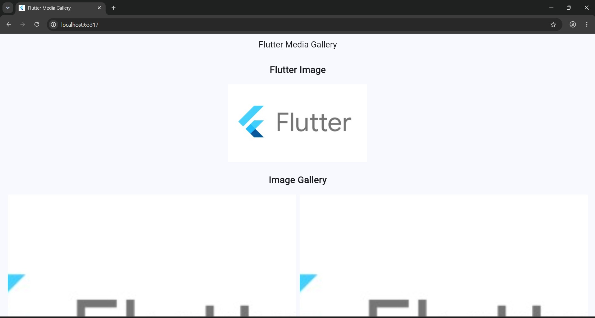
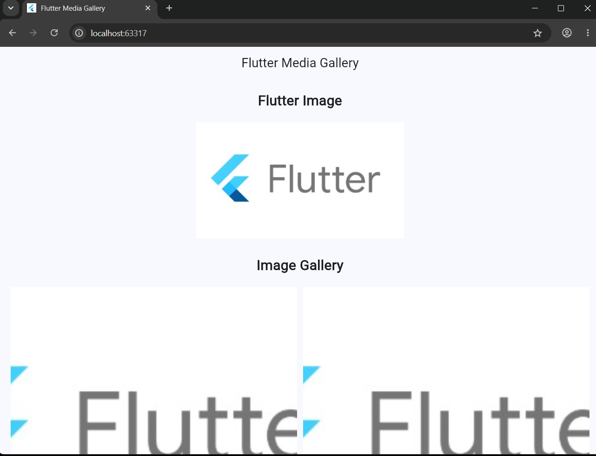
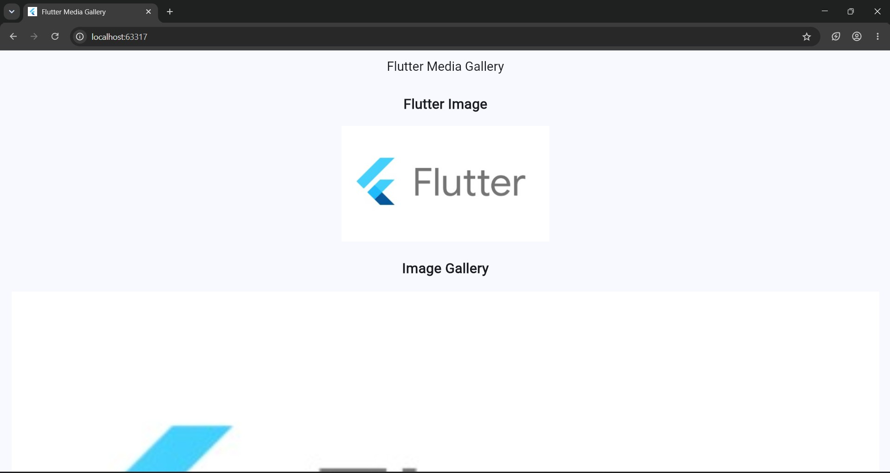

# Experiment 4: Utilize the Assets and Media

**Course:** 24CS2016 Building Applications using Flutter  
**Student:** Santhosh V (URK23CS1003)  
**Date:** 07/09/26

## Aim
To add and display image, audio and video assets in a Flutter application.

**Concepts:** assets folder, `pubspec.yaml` assets registration, Image.asset, GridView.count

## Quick run (using the files in this repo)

Platform folders (`android/`, `ios/`, `web/` ...) are not stored in the repo; generate them once:

```bash
cd experiment_4
flutter create --project-name experiment_4 .   # generates platform folders, keeps existing lib/ and pubspec.yaml
flutter pub get
flutter analyze      # expected: No issues found!
flutter test         # expected: All tests passed!
flutter run -d chrome
```

## Step-by-step procedure (from scratch)

**Step 1 - Create the project**

```bash
flutter create --project-name experiment_4 experiment_4
cd experiment_4
```

**Step 2 - Create the asset directories**

```text
experiment_4/
+-- assets/
    +-- images/      <- flutter.jpeg goes here
    +-- audio/       (optional, not used in the output)
    +-- video/       (optional, not used in the output)
```

**Step 3 - Copy an image**

Put any image into `assets/images/` (this repo uses `assets/images/flutter.jpeg`).

**Step 4 - Register assets in `pubspec.yaml`**

```yaml
flutter:
  uses-material-design: true
  assets:
    - assets/images/
```
**YAML is indentation-sensitive** - `assets:` must be indented exactly 2 spaces under `flutter:`.

**Step 5 - Fetch packages**

```bash
flutter pub get
```

**Step 6 - Display a single image**

```dart
Image.asset('assets/images/flutter.jpeg', height: 200)
```

**Step 7 - Build the gallery**

```dart
GridView.count(
  crossAxisCount: 2,
  shrinkWrap: true,
  physics: const NeverScrollableScrollPhysics(),
  children: [ Image.asset('assets/images/flutter.jpeg'), ... ],
)
```

**Step 8 - Run**

```bash
flutter run -d chrome
```
If you see `Unable to load asset`, re-check the YAML indentation and run `flutter clean && flutter pub get`, then run again (hot-reload does not pick up pubspec changes).

## Files

```text
experiment_4/
+-- lib/main.dart
+-- test/widget_test.dart
+-- pubspec.yaml
+-- assets/images/flutter.jpeg
+-- output/   (screenshots)
```

## Complete code

### `lib/main.dart`
```dart
import 'package:flutter/material.dart';

void main() {
  runApp(const MyApp());
}

class MyApp extends StatelessWidget {
  const MyApp({super.key});

  @override
  Widget build(BuildContext context) {
    return MaterialApp(
      debugShowCheckedModeBanner: false,
      title: 'Flutter Media Gallery',
      theme: ThemeData(useMaterial3: true, colorSchemeSeed: Colors.blue),
      home: const MediaHomePage(),
    );
  }
}

class MediaHomePage extends StatelessWidget {
  const MediaHomePage({super.key});

  @override
  Widget build(BuildContext context) {
    return Scaffold(
      appBar: AppBar(
        title: const Text('Flutter Media Gallery'),
        centerTitle: true,
      ),
      body: SingleChildScrollView(
        padding: const EdgeInsets.all(20),
        child: Column(
          crossAxisAlignment: CrossAxisAlignment.stretch,
          children: [
            const Text(
              'Flutter Image',
              textAlign: TextAlign.center,
              style: TextStyle(fontSize: 24, fontWeight: FontWeight.bold),
            ),
            const SizedBox(height: 20),

            // Single image from assets
            Image.asset('assets/images/flutter.jpeg', height: 200),
            const SizedBox(height: 30),

            const Text(
              'Image Gallery',
              textAlign: TextAlign.center,
              style: TextStyle(fontSize: 24, fontWeight: FontWeight.bold),
            ),
            const SizedBox(height: 20),

            // Image gallery: 2 columns
            GridView.count(
              crossAxisCount: 2,
              shrinkWrap: true,
              physics: const NeverScrollableScrollPhysics(),
              crossAxisSpacing: 10,
              mainAxisSpacing: 10,
              children: [
                Image.asset('assets/images/flutter.jpeg'),
                Image.asset('assets/images/flutter.jpeg'),
                Image.asset('assets/images/flutter.jpeg'),
                Image.asset('assets/images/flutter.jpeg'),
              ],
            ),
          ],
        ),
      ),
    );
  }
}
```

### `test/widget_test.dart`
```dart
import 'package:flutter/material.dart';
import 'package:flutter_test/flutter_test.dart';

import 'package:experiment_4/main.dart';

void main() {
  testWidgets('Media gallery shows image assets', (tester) async {
    tester.view.physicalSize = const Size(800, 1600);
    tester.view.devicePixelRatio = 1.0;
    addTearDown(tester.view.resetPhysicalSize);
    addTearDown(tester.view.resetDevicePixelRatio);

    await tester.pumpWidget(const MyApp());

    expect(find.text('Flutter Media Gallery'), findsOneWidget);
    expect(find.text('Flutter Image'), findsOneWidget);
    expect(find.text('Image Gallery'), findsOneWidget);
    expect(find.byType(GridView), findsOneWidget);
    expect(find.byType(Image), findsWidgets);
  });
}
```

### `pubspec.yaml`
```yaml
name: experiment_4
description: "A new Flutter project."
# The following line prevents the package from being accidentally published to
# pub.dev using `flutter pub publish`. This is preferred for private packages.
publish_to: 'none' # Remove this line if you wish to publish to pub.dev

# The following defines the version and build number for your application.
# A version number is three numbers separated by dots, like 1.2.43
# followed by an optional build number separated by a +.
# Both the version and the builder number may be overridden in flutter
# build by specifying --build-name and --build-number, respectively.
# In Android, build-name is used as versionName while build-number used as versionCode.
# Read more about Android versioning at https://developer.android.com/studio/publish/versioning
# In iOS, build-name is used as CFBundleShortVersionString while build-number is used as CFBundleVersion.
# Read more about iOS versioning at
# https://developer.apple.com/library/archive/documentation/General/Reference/InfoPlistKeyReference/Articles/CoreFoundationKeys.html
# In Windows, build-name is used as the major, minor, and patch parts
# of the product and file versions while build-number is used as the build suffix.
version: 1.0.0+1

environment:
  sdk: ^3.13.2

# Dependencies specify other packages that your package needs in order to work.
# To automatically upgrade your package dependencies to the latest versions
# consider running `flutter pub upgrade --major-versions`. Alternatively,
# dependencies can be manually updated by changing the version numbers below to
# the latest version available on pub.dev. To see which dependencies have newer
# versions available, run `flutter pub outdated`.
dependencies:
  flutter:
    sdk: flutter

  # The following adds the Cupertino Icons font to your application.
  # Use with the CupertinoIcons class for iOS style icons.
  cupertino_icons: ^1.0.8

dev_dependencies:
  flutter_test:
    sdk: flutter

  # The "flutter_lints" package below contains a set of recommended lints to
  # encourage good coding practices. The lint set provided by the package is
  # activated in the `analysis_options.yaml` file located at the root of your
  # package. See that file for information about deactivating specific lint
  # rules and activating additional ones.
  flutter_lints: ^6.0.0

# For information on the generic Dart part of this file, see the
# following page: https://dart.dev/tools/pub/pubspec

# The following section is specific to Flutter packages.
flutter:

  uses-material-design: true

  assets:
    - assets/images/

  # To add assets to your application, add an assets section, like this:
  # assets:
  #   - images/a_dot_burr.jpeg
  #   - images/a_dot_ham.jpeg

  # An image asset can refer to one or more resolution-specific "variants", see
  # https://flutter.dev/to/resolution-aware-images

  # For details regarding adding assets from package dependencies, see
  # https://flutter.dev/to/asset-from-package

  # To add custom fonts to your application, add a fonts section here,
  # in this "flutter" section. Each entry in this list should have a
  # "family" key with the font family name, and a "fonts" key with a
  # list giving the asset and other descriptors for the font. For
  # example:
  # fonts:
  #   - family: Schyler
  #     fonts:
  #       - asset: fonts/Schyler-Regular.ttf
  #       - asset: fonts/Schyler-Italic.ttf
  #         style: italic
  #   - family: Trajan Pro
  #     fonts:
  #       - asset: fonts/TrajanPro.ttf
  #       - asset: fonts/TrajanPro_Bold.ttf
  #         weight: 700
  #
  # For details regarding fonts from package dependencies,
  # see https://flutter.dev/to/font-from-package
```

## Expected output

**Single image + 2-column gallery**



**Same screen, larger window**



**Earlier variant (single wide image) - not produced by this repo's code**



- AppBar: **Flutter Media Gallery**
- Heading `Flutter Image`, then the Flutter logo (200 px high) loaded from `assets/images/flutter.jpeg`.
- Heading `Image Gallery`, then the same image repeated in a **2-column grid** (`GridView.count`, `crossAxisCount: 2`). Images are drawn at natural size, so each cell shows the logo cropped to its cell (as in the screenshot).

## Result
A Flutter media application was created and configured to use local image assets. The asset directory was added and registered correctly in pubspec.yaml. The configured image was displayed using Image.asset and arranged in a gallery using GridView.count.
