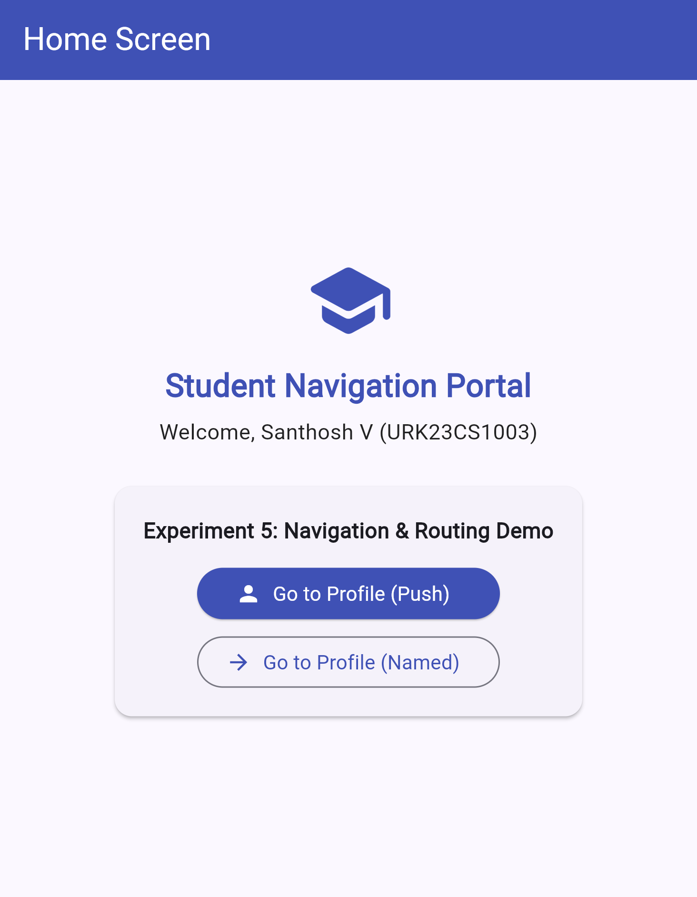
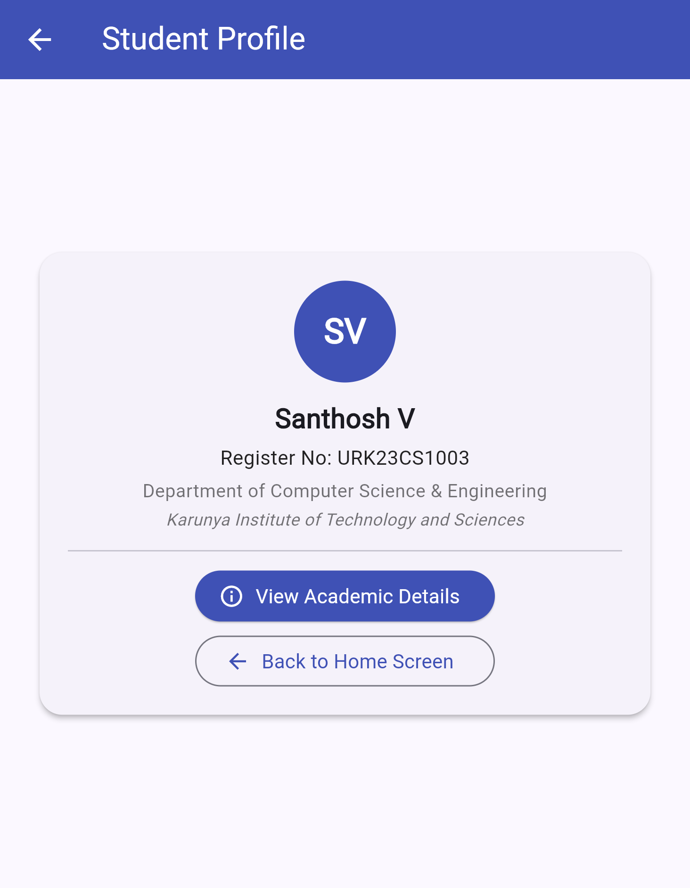
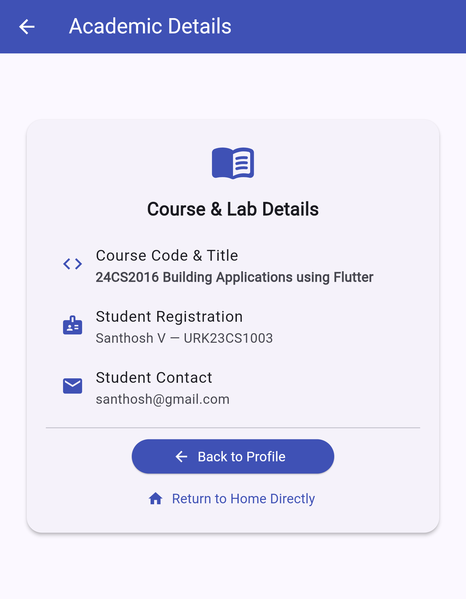

# Experiment 5: Implementation of Navigation and Routing

**Course:** 24CS2016 Building Applications using Flutter  
**Student:** Santhosh V (URK23CS1003)  
**Date:** 21/09/26

## Aim
To implement navigation between multiple Flutter screens using direct and named routes.

**Concepts:** Navigator.push, Navigator.pop, MaterialPageRoute, named routes (`routes:` table, `initialRoute`, `Navigator.pushNamed`), multi-file project

## Quick run (using the files in this repo)

Platform folders (`android/`, `ios/`, `web/` ...) are not stored in the repo; generate them once:

```bash
cd experiment_5
flutter create --project-name experiment_5 .   # generates platform folders, keeps existing lib/ and pubspec.yaml
flutter pub get
flutter analyze      # expected: No issues found!
flutter test         # expected: All tests passed!
flutter run -d chrome
```

## Step-by-step procedure (from scratch)

**Step 1 - Create the project**

```bash
flutter create --project-name experiment_5 experiment_5
cd experiment_5
```

**Step 2 - Create three screen files in `lib/`**

```text
lib/
+-- main.dart
+-- home.dart
+-- profile.dart
+-- details.dart
```

**Step 3 - Home -> Profile (direct push)**

```dart
Navigator.push(
  context,
  MaterialPageRoute(builder: (context) => const ProfilePage()),
);
```

**Step 4 - Profile -> Details (direct push)**

```dart
Navigator.push(
  context,
  MaterialPageRoute(builder: (context) => const DetailsPage()),
);
```

**Step 5 - Go back**

```dart
Navigator.pop(context);
```

**Step 6 - Add named routes in `MaterialApp` (`main.dart`)**

```dart
initialRoute: '/',
routes: {
  '/': (context) => const HomePage(),
  '/profile': (context) => const ProfilePage(),
  '/details': (context) => const DetailsPage(),
},
```

**Step 7 - Navigate by name**

```dart
Navigator.pushNamed(context, '/profile');
```

**Step 8 - Run, then click through all screens**

```bash
flutter test
flutter run -d chrome
```

## Files

```text
experiment_5/
+-- lib/main.dart
+-- lib/details.dart
+-- lib/home.dart
+-- lib/profile.dart
+-- test/widget_test.dart
+-- pubspec.yaml
+-- output/   (screenshots)
```

## Complete code

### `lib/main.dart`
```dart
import 'package:flutter/material.dart';
import 'home.dart';
import 'profile.dart';
import 'details.dart';

void main() {
  runApp(const NavigationApp());
}

class NavigationApp extends StatelessWidget {
  const NavigationApp({super.key});

  @override
  Widget build(BuildContext context) {
    return MaterialApp(
      title: 'Experiment 5 - Navigation & Routing',
      debugShowCheckedModeBanner: false,
      theme: ThemeData(
        colorScheme: ColorScheme.fromSeed(seedColor: Colors.indigo),
        useMaterial3: true,
      ),
      initialRoute: '/',
      routes: {
        '/': (context) => const HomePage(),
        '/profile': (context) => const ProfilePage(),
        '/details': (context) => const DetailsPage(),
      },
    );
  }
}
```

### `lib/details.dart`
```dart
import 'package:flutter/material.dart';

class DetailsPage extends StatelessWidget {
  const DetailsPage({super.key});

  @override
  Widget build(BuildContext context) {
    return Scaffold(
      appBar: AppBar(
        title: const Text('Academic Details'),
        backgroundColor: Colors.indigo,
        foregroundColor: Colors.white,
      ),
      body: Center(
        child: SingleChildScrollView(
          padding: const EdgeInsets.symmetric(horizontal: 24.0, vertical: 16.0),
          child: Column(
            mainAxisAlignment: MainAxisAlignment.center,
            children: [
              Card(
                elevation: 3,
                shape: RoundedRectangleBorder(
                  borderRadius: BorderRadius.circular(16),
                ),
                child: Padding(
                  padding: const EdgeInsets.all(20.0),
                  child: Column(
                    children: [
                      const Icon(
                        Icons.menu_book_rounded,
                        size: 48,
                        color: Colors.indigo,
                      ),
                      const SizedBox(height: 12),
                      const Text(
                        'Course & Lab Details',
                        style: TextStyle(
                          fontSize: 19,
                          fontWeight: FontWeight.bold,
                        ),
                      ),
                      const SizedBox(height: 12),
                      const ListTile(
                        leading: Icon(Icons.code, color: Colors.indigo),
                        title: Text('Course Code & Title'),
                        subtitle: Text(
                          '24CS2016 Building Applications using Flutter',
                          style: TextStyle(fontWeight: FontWeight.w600),
                        ),
                      ),
                      const ListTile(
                        leading: Icon(Icons.badge, color: Colors.indigo),
                        title: Text('Student Registration'),
                        subtitle: Text('Santhosh V — URK23CS1003'),
                      ),
                      const ListTile(
                        leading: Icon(Icons.email, color: Colors.indigo),
                        title: Text('Student Contact'),
                        subtitle: Text('santhosh@gmail.com'),
                      ),
                      const Divider(height: 24),
                      ElevatedButton.icon(
                        style: ElevatedButton.styleFrom(
                          backgroundColor: Colors.indigo,
                          foregroundColor: Colors.white,
                          minimumSize: const Size(220, 44),
                        ),
                        onPressed: () {
                          Navigator.pop(context);
                        },
                        icon: const Icon(Icons.arrow_back),
                        label: const Text('Back to Profile'),
                      ),
                      const SizedBox(height: 10),
                      TextButton.icon(
                        style: TextButton.styleFrom(
                          foregroundColor: Colors.indigo,
                        ),
                        onPressed: () {
                          Navigator.popUntil(context, (route) => route.isFirst);
                        },
                        icon: const Icon(Icons.home),
                        label: const Text('Return to Home Directly'),
                      ),
                    ],
                  ),
                ),
              ),
            ],
          ),
        ),
      ),
    );
  }
}
```

### `lib/home.dart`
```dart
import 'package:flutter/material.dart';
import 'profile.dart';

class HomePage extends StatelessWidget {
  const HomePage({super.key});

  @override
  Widget build(BuildContext context) {
    return Scaffold(
      appBar: AppBar(
        title: const Text('Home Screen'),
        backgroundColor: Colors.indigo,
        foregroundColor: Colors.white,
      ),
      body: Center(
        child: SingleChildScrollView(
          padding: const EdgeInsets.symmetric(horizontal: 24.0, vertical: 16.0),
          child: Column(
            mainAxisAlignment: MainAxisAlignment.center,
            children: [
              const Icon(
                Icons.school_rounded,
                size: 64,
                color: Colors.indigo,
              ),
              const SizedBox(height: 12),
              const Text(
                'Student Navigation Portal',
                style: TextStyle(
                  fontSize: 22,
                  fontWeight: FontWeight.bold,
                  color: Colors.indigo,
                ),
              ),
              const SizedBox(height: 6),
              const Text(
                'Welcome, Santhosh V (URK23CS1003)',
                style: TextStyle(fontSize: 15, color: Colors.black87),
              ),
              const SizedBox(height: 24),
              Card(
                elevation: 2,
                shape: RoundedRectangleBorder(
                  borderRadius: BorderRadius.circular(12),
                ),
                child: Padding(
                  padding: const EdgeInsets.all(20.0),
                  child: Column(
                    children: [
                      const Text(
                        'Experiment 5: Navigation & Routing Demo',
                        style: TextStyle(
                          fontSize: 15,
                          fontWeight: FontWeight.w600,
                        ),
                      ),
                      const SizedBox(height: 16),
                      ElevatedButton.icon(
                        style: ElevatedButton.styleFrom(
                          backgroundColor: Colors.indigo,
                          foregroundColor: Colors.white,
                          minimumSize: const Size(220, 44),
                        ),
                        onPressed: () {
                          Navigator.push(
                            context,
                            MaterialPageRoute(
                              builder: (context) => const ProfilePage(),
                            ),
                          );
                        },
                        icon: const Icon(Icons.person),
                        label: const Text('Go to Profile (Push)'),
                      ),
                      const SizedBox(height: 12),
                      OutlinedButton.icon(
                        style: OutlinedButton.styleFrom(
                          foregroundColor: Colors.indigo,
                          minimumSize: const Size(220, 44),
                        ),
                        onPressed: () {
                          Navigator.pushNamed(context, '/profile');
                        },
                        icon: const Icon(Icons.arrow_forward),
                        label: const Text('Go to Profile (Named)'),
                      ),
                    ],
                  ),
                ),
              ),
            ],
          ),
        ),
      ),
    );
  }
}
```

### `lib/profile.dart`
```dart
import 'package:flutter/material.dart';
import 'details.dart';

class ProfilePage extends StatelessWidget {
  const ProfilePage({super.key});

  @override
  Widget build(BuildContext context) {
    return Scaffold(
      appBar: AppBar(
        title: const Text('Student Profile'),
        backgroundColor: Colors.indigo,
        foregroundColor: Colors.white,
      ),
      body: Center(
        child: SingleChildScrollView(
          padding: const EdgeInsets.symmetric(horizontal: 24.0, vertical: 16.0),
          child: Column(
            mainAxisAlignment: MainAxisAlignment.center,
            children: [
              Card(
                elevation: 3,
                shape: RoundedRectangleBorder(
                  borderRadius: BorderRadius.circular(16),
                ),
                child: Padding(
                  padding: const EdgeInsets.all(20.0),
                  child: Column(
                    children: [
                      const CircleAvatar(
                        radius: 36,
                        backgroundColor: Colors.indigo,
                        child: Text(
                          'SV',
                          style: TextStyle(
                            fontSize: 24,
                            color: Colors.white,
                            fontWeight: FontWeight.bold,
                          ),
                        ),
                      ),
                      const SizedBox(height: 12),
                      const Text(
                        'Santhosh V',
                        style: TextStyle(
                          fontSize: 19,
                          fontWeight: FontWeight.bold,
                        ),
                      ),
                      const SizedBox(height: 4),
                      const Text(
                        'Register No: URK23CS1003',
                        style: TextStyle(fontSize: 14, color: Colors.black87),
                      ),
                      const SizedBox(height: 4),
                      const Text(
                        'Department of Computer Science & Engineering',
                        textAlign: TextAlign.center,
                        style: TextStyle(fontSize: 13, color: Colors.black54),
                      ),
                      const SizedBox(height: 2),
                      const Text(
                        'Karunya Institute of Technology and Sciences',
                        textAlign: TextAlign.center,
                        style: TextStyle(
                          fontSize: 12,
                          fontStyle: FontStyle.italic,
                          color: Colors.black54,
                        ),
                      ),
                      const Divider(height: 28),
                      ElevatedButton.icon(
                        style: ElevatedButton.styleFrom(
                          backgroundColor: Colors.indigo,
                          foregroundColor: Colors.white,
                          minimumSize: const Size(220, 44),
                        ),
                        onPressed: () {
                          Navigator.push(
                            context,
                            MaterialPageRoute(
                              builder: (context) => const DetailsPage(),
                            ),
                          );
                        },
                        icon: const Icon(Icons.info_outline),
                        label: const Text('View Academic Details'),
                      ),
                      const SizedBox(height: 10),
                      OutlinedButton.icon(
                        style: OutlinedButton.styleFrom(
                          foregroundColor: Colors.indigo,
                          minimumSize: const Size(220, 44),
                        ),
                        onPressed: () {
                          Navigator.pop(context);
                        },
                        icon: const Icon(Icons.arrow_back),
                        label: const Text('Back to Home Screen'),
                      ),
                    ],
                  ),
                ),
              ),
            ],
          ),
        ),
      ),
    );
  }
}
```

### `test/widget_test.dart`
```dart
import 'package:flutter_test/flutter_test.dart';
import 'package:experiment_5/main.dart';

void main() {
  testWidgets('Navigation flow between Home, Profile, and Details screens', (WidgetTester tester) async {
    await tester.pumpWidget(const NavigationApp());

    // Verify Home Screen is displayed
    expect(find.text('Student Navigation Portal'), findsOneWidget);
    expect(find.text('Welcome, Santhosh V (URK23CS1003)'), findsOneWidget);

    // Tap 'Go to Profile (Push)'
    await tester.tap(find.text('Go to Profile (Push)'));
    await tester.pumpAndSettle();

    // Verify Profile Screen
    expect(find.text('Student Profile'), findsOneWidget);
    expect(find.text('Register No: URK23CS1003'), findsOneWidget);

    // Tap 'View Academic Details'
    await tester.tap(find.text('View Academic Details'));
    await tester.pumpAndSettle();

    // Verify Details Screen
    expect(find.text('Academic Details'), findsOneWidget);
    expect(find.text('24CS2016 Building Applications using Flutter'), findsOneWidget);

    // Pop back to Profile
    await tester.tap(find.text('Back to Profile'));
    await tester.pumpAndSettle();

    expect(find.text('Student Profile'), findsOneWidget);

    // Pop back to Home
    await tester.tap(find.text('Back to Home Screen'));
    await tester.pumpAndSettle();

    expect(find.text('Student Navigation Portal'), findsOneWidget);

    // Tap named route
    await tester.tap(find.text('Go to Profile (Named)'));
    await tester.pumpAndSettle();

    expect(find.text('Student Profile'), findsOneWidget);
  });
}
```

### `pubspec.yaml`
```yaml
name: experiment_5
description: "A new Flutter project."
# The following line prevents the package from being accidentally published to
# pub.dev using `flutter pub publish`. This is preferred for private packages.
publish_to: 'none' # Remove this line if you wish to publish to pub.dev

# The following defines the version and build number for your application.
# A version number is three numbers separated by dots, like 1.2.43
# followed by an optional build number separated by a +.
# Both the version and the builder number may be overridden in flutter
# build by specifying --build-name and --build-number, respectively.
# In Android, build-name is used as versionName while build-number used as versionCode.
# Read more about Android versioning at https://developer.android.com/studio/publish/versioning
# In iOS, build-name is used as CFBundleShortVersionString while build-number is used as CFBundleVersion.
# Read more about iOS versioning at
# https://developer.apple.com/library/archive/documentation/General/Reference/InfoPlistKeyReference/Articles/CoreFoundationKeys.html
# In Windows, build-name is used as the major, minor, and patch parts
# of the product and file versions while build-number is used as the build suffix.
version: 1.0.0+1

environment:
  sdk: ^3.13.2

# Dependencies specify other packages that your package needs in order to work.
# To automatically upgrade your package dependencies to the latest versions
# consider running `flutter pub upgrade --major-versions`. Alternatively,
# dependencies can be manually updated by changing the version numbers below to
# the latest version available on pub.dev. To see which dependencies have newer
# versions available, run `flutter pub outdated`.
dependencies:
  flutter:
    sdk: flutter

  # The following adds the Cupertino Icons font to your application.
  # Use with the CupertinoIcons class for iOS style icons.
  cupertino_icons: ^1.0.8

dev_dependencies:
  flutter_test:
    sdk: flutter

  # The "flutter_lints" package below contains a set of recommended lints to
  # encourage good coding practices. The lint set provided by the package is
  # activated in the `analysis_options.yaml` file located at the root of your
  # package. See that file for information about deactivating specific lint
  # rules and activating additional ones.
  flutter_lints: ^6.0.0

# For information on the generic Dart part of this file, see the
# following page: https://dart.dev/tools/pub/pubspec

# The following section is specific to Flutter packages.
flutter:

  # The following line ensures that the Material Icons font is
  # included with your application, so that you can use the icons in
  # the material Icons class.
  uses-material-design: true

  # To add assets to your application, add an assets section, like this:
  # assets:
  #   - images/a_dot_burr.jpeg
  #   - images/a_dot_ham.jpeg

  # An image asset can refer to one or more resolution-specific "variants", see
  # https://flutter.dev/to/resolution-aware-images

  # For details regarding adding assets from package dependencies, see
  # https://flutter.dev/to/asset-from-package

  # To add custom fonts to your application, add a fonts section here,
  # in this "flutter" section. Each entry in this list should have a
  # "family" key with the font family name, and a "fonts" key with a
  # list giving the asset and other descriptors for the font. For
  # example:
  # fonts:
  #   - family: Schyler
  #     fonts:
  #       - asset: fonts/Schyler-Regular.ttf
  #       - asset: fonts/Schyler-Italic.ttf
  #         style: italic
  #   - family: Trajan Pro
  #     fonts:
  #       - asset: fonts/TrajanPro.ttf
  #       - asset: fonts/TrajanPro_Bold.ttf
  #         weight: 700
  #
  # For details regarding fonts from package dependencies,
  # see https://flutter.dev/to/font-from-package
```

## Expected output

**Home Screen**



**Student Profile**



**Academic Details**



1. **Home Screen** - `Student Navigation Portal`, `Welcome, Santhosh V (URK23CS1003)`, buttons **Go to Profile (Push)** and **Go to Profile (Named)**.
2. **Student Profile** - avatar `SV`, `Register No: URK23CS1003`, buttons **View Academic Details** and **Back to Home Screen**.
3. **Academic Details** - course code/title `24CS2016 Building Applications using Flutter`, registration, contact; buttons **Back to Profile** and **Return to Home Directly**.
4. Back arrow / Back buttons pop to the previous screen.

## Result
A Flutter application with multiple screens was developed successfully. The Home, Profile, and Details screens were connected using navigation routes. Navigator.push and Navigator.pop were used to move between screens and return to prior views. Named routes were configured and verified to open application screens by route name.
