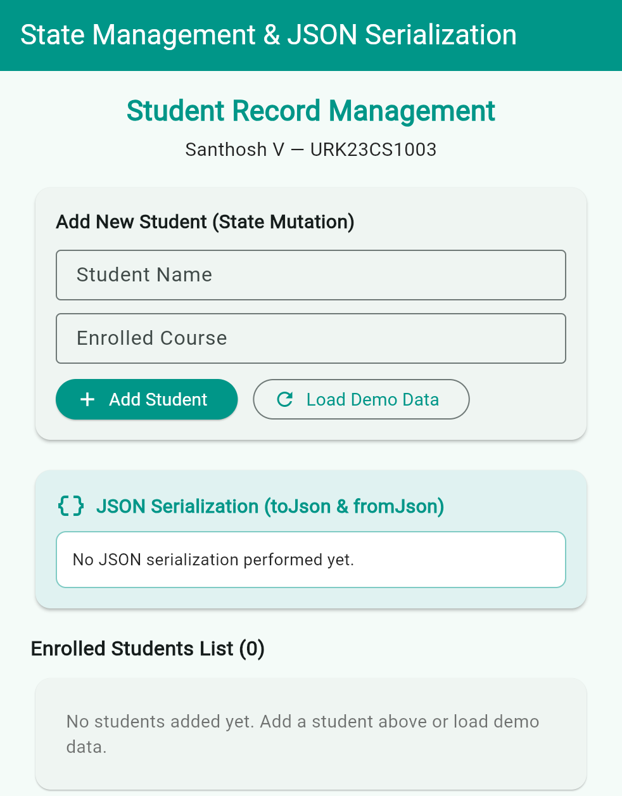
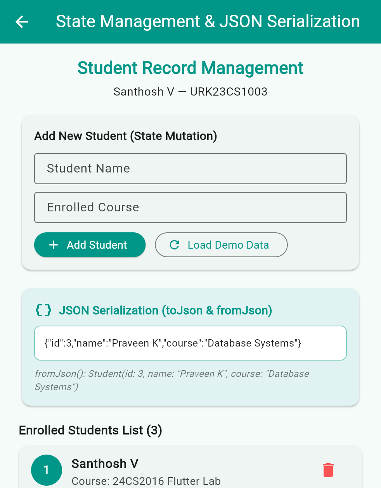

# Experiment 7: Application State Management and Serialization

**Course:** 24CS2016 Building Applications using Flutter  
**Student:** Santhosh V (URK23CS1003)  
**Date:** 21/09/26

## Aim
To manage application state and serialize/deserialize structured student data using JSON in Flutter.

**Concepts:** StatefulWidget + setState (ephemeral state), model class, `toJson()`, `factory fromJson()`, `jsonEncode` / `jsonDecode` (`dart:convert`)

## Quick run (using the files in this repo)

Platform folders (`android/`, `ios/`, `web/` ...) are not stored in the repo; generate them once:

```bash
cd experiment_7
flutter create --project-name experiment_7 .   # generates platform folders, keeps existing lib/ and pubspec.yaml
flutter pub get
flutter analyze      # expected: No issues found!
flutter test         # expected: All tests passed!
flutter run -d chrome
```

## Step-by-step procedure (from scratch)

**Step 1 - Create the project**

```bash
flutter create --project-name experiment_7 experiment_7
cd experiment_7
```

**Step 2 - Create `lib/student.dart` (model with serialization)**

```dart
class Student {
  final int id;
  final String name;
  final String course;
  Student({required this.id, required this.name, required this.course});

  Map<String, dynamic> toJson() => {'id': id, 'name': name, 'course': course};

  factory Student.fromJson(Map<String, dynamic> json) => Student(
        id: json['id'] as int,
        name: json['name'] as String,
        course: json['course'] as String,
      );
}
```

**Step 3 - In `main.dart` keep a `List<Student>` in a StatefulWidget**

Adding/removing a student = change the list inside `setState(() { ... })`.

**Step 4 - Serialize and deserialize**

```dart
final jsonStr = jsonEncode(student.toJson());          // object -> JSON string
final back = Student.fromJson(jsonDecode(jsonStr));    // JSON string -> object
```

**Step 5 - Show both strings in the UI**

A text box shows `{"id":1,...}` and a line shows `fromJson(): Student(...)`.

**Step 6 - Run**

```bash
flutter test
flutter run -d chrome
```

## Files

```text
experiment_7/
+-- lib/main.dart
+-- lib/student.dart
+-- test/widget_test.dart
+-- pubspec.yaml
+-- output/   (screenshots)
```

## Complete code

### `lib/main.dart`
```dart
import 'dart:convert';
import 'package:flutter/material.dart';
import 'student.dart';

void main() {
  runApp(const StateApp());
}

class StateApp extends StatelessWidget {
  const StateApp({super.key});

  @override
  Widget build(BuildContext context) {
    return MaterialApp(
      title: 'Experiment 7 - State Management & Serialization',
      debugShowCheckedModeBanner: false,
      theme: ThemeData(
        colorScheme: ColorScheme.fromSeed(seedColor: Colors.teal),
        useMaterial3: true,
      ),
      initialRoute: '/',
      routes: {
        '/': (context) => const StudentStatePage(),
        '/serialized': (context) => const StudentStatePage(initialWithData: true),
      },
    );
  }
}

class StudentStatePage extends StatefulWidget {
  final bool initialWithData;
  const StudentStatePage({super.key, this.initialWithData = false});

  @override
  State<StudentStatePage> createState() => _StudentStatePageState();
}

class _StudentStatePageState extends State<StudentStatePage> {
  final List<Student> _students = [];
  final _nameController = TextEditingController();
  final _courseController = TextEditingController();
  String _jsonOutput = 'No JSON serialization performed yet.';
  String _deserializedInfo = '';

  @override
  void initState() {
    super.initState();
    if (widget.initialWithData) {
      _loadDefaultSampleData();
    }
  }

  void _loadDefaultSampleData() {
    final s1 = Student(id: 1, name: 'Santhosh V', course: '24CS2016 Flutter Lab');
    final s2 = Student(id: 2, name: 'Adithya R', course: 'Operating Systems');
    final s3 = Student(id: 3, name: 'Praveen K', course: 'Database Systems');
    _students.addAll([s1, s2, s3]);
    _serializeLastStudent();
  }

  @override
  void dispose() {
    _nameController.dispose();
    _courseController.dispose();
    super.dispose();
  }

  void _addStudent() {
    final name = _nameController.text.trim();
    final course = _courseController.text.trim();
    if (name.isEmpty || course.isEmpty) {
      ScaffoldMessenger.of(context).showSnackBar(
        const SnackBar(content: Text('Please enter student name and course!')),
      );
      return;
    }

    setState(() {
      final newStudent = Student(
        id: _students.length + 1,
        name: name,
        course: course,
      );
      _students.add(newStudent);
      _nameController.clear();
      _courseController.clear();
      _serializeLastStudent();
    });
  }

  void _serializeLastStudent() {
    if (_students.isEmpty) return;
    final last = _students.last;
    final Map<String, dynamic> data = last.toJson();
    final jsonStr = jsonEncode(data);

    // Demonstrate deserialization back to object
    final Student deserialized = Student.fromJson(jsonDecode(jsonStr));

    setState(() {
      _jsonOutput = jsonStr;
      _deserializedInfo =
          'fromJson(): Student(id: ${deserialized.id}, name: "${deserialized.name}", course: "${deserialized.course}")';
    });
  }

  void _removeStudent(int index) {
    setState(() {
      _students.removeAt(index);
      if (_students.isNotEmpty) {
        _serializeLastStudent();
      } else {
        _jsonOutput = 'List is empty.';
        _deserializedInfo = '';
      }
    });
  }

  @override
  Widget build(BuildContext context) {
    return Scaffold(
      appBar: AppBar(
        title: const Text('State Management & JSON Serialization'),
        backgroundColor: Colors.teal,
        foregroundColor: Colors.white,
      ),
      body: SingleChildScrollView(
        padding: const EdgeInsets.symmetric(horizontal: 24.0, vertical: 16.0),
        child: Column(
          crossAxisAlignment: CrossAxisAlignment.stretch,
          children: [
            const Center(
              child: Column(
                children: [
                  Text(
                    'Student Record Management',
                    style: TextStyle(
                      fontSize: 22,
                      fontWeight: FontWeight.bold,
                      color: Colors.teal,
                    ),
                  ),
                  SizedBox(height: 4),
                  Text(
                    'Santhosh V — URK23CS1003',
                    style: TextStyle(fontSize: 15, color: Colors.black87),
                  ),
                ],
              ),
            ),
            const SizedBox(height: 16),
            Card(
              elevation: 2,
              shape: RoundedRectangleBorder(
                borderRadius: BorderRadius.circular(12),
              ),
              child: Padding(
                padding: const EdgeInsets.all(16.0),
                child: Column(
                  crossAxisAlignment: CrossAxisAlignment.start,
                  children: [
                    const Text(
                      'Add New Student (State Mutation)',
                      style: TextStyle(
                        fontSize: 15,
                        fontWeight: FontWeight.bold,
                      ),
                    ),
                    const SizedBox(height: 12),
                    TextField(
                      controller: _nameController,
                      decoration: const InputDecoration(
                        labelText: 'Student Name',
                        hintText: 'e.g. Santhosh V',
                        border: OutlineInputBorder(),
                        isDense: true,
                      ),
                    ),
                    const SizedBox(height: 10),
                    TextField(
                      controller: _courseController,
                      decoration: const InputDecoration(
                        labelText: 'Enrolled Course',
                        hintText: 'e.g. 24CS2016 Flutter Lab',
                        border: OutlineInputBorder(),
                        isDense: true,
                      ),
                    ),
                    const SizedBox(height: 12),
                    Row(
                      children: [
                        ElevatedButton.icon(
                          style: ElevatedButton.styleFrom(
                            backgroundColor: Colors.teal,
                            foregroundColor: Colors.white,
                          ),
                          onPressed: _addStudent,
                          icon: const Icon(Icons.add),
                          label: const Text('Add Student'),
                        ),
                        const SizedBox(width: 12),
                        OutlinedButton.icon(
                          style: OutlinedButton.styleFrom(
                            foregroundColor: Colors.teal,
                          ),
                          onPressed: () {
                            setState(() {
                              _loadDefaultSampleData();
                            });
                          },
                          icon: const Icon(Icons.refresh),
                          label: const Text('Load Demo Data'),
                        ),
                      ],
                    ),
                  ],
                ),
              ),
            ),
            const SizedBox(height: 16),
            Card(
              elevation: 2,
              color: Colors.teal.shade50,
              shape: RoundedRectangleBorder(
                borderRadius: BorderRadius.circular(12),
              ),
              child: Padding(
                padding: const EdgeInsets.all(16.0),
                child: Column(
                  crossAxisAlignment: CrossAxisAlignment.start,
                  children: [
                    const Row(
                      children: [
                        Icon(Icons.data_object, color: Colors.teal),
                        SizedBox(width: 8),
                        Text(
                          'JSON Serialization (toJson & fromJson)',
                          style: TextStyle(
                            fontSize: 15,
                            fontWeight: FontWeight.bold,
                            color: Colors.teal,
                          ),
                        ),
                      ],
                    ),
                    const SizedBox(height: 8),
                    Container(
                      width: double.infinity,
                      padding: const EdgeInsets.all(12),
                      decoration: BoxDecoration(
                        color: Colors.white,
                        borderRadius: BorderRadius.circular(8),
                        border: Border.all(color: Colors.teal.shade200),
                      ),
                      child: SelectableText(
                        _jsonOutput,
                        style: const TextStyle(
                          fontFamily: 'monospace',
                          fontSize: 13,
                          color: Colors.black87,
                        ),
                      ),
                    ),
                    if (_deserializedInfo.isNotEmpty) ...[
                      const SizedBox(height: 8),
                      Text(
                        _deserializedInfo,
                        style: const TextStyle(
                          fontSize: 12,
                          color: Colors.black54,
                          fontStyle: FontStyle.italic,
                        ),
                      ),
                    ],
                  ],
                ),
              ),
            ),
            const SizedBox(height: 16),
            Text(
              'Enrolled Students List (${_students.length})',
              style: const TextStyle(
                fontSize: 16,
                fontWeight: FontWeight.bold,
              ),
            ),
            const SizedBox(height: 8),
            _students.isEmpty
                ? const Card(
                    child: Padding(
                      padding: EdgeInsets.all(24.0),
                      child: Center(
                        child: Text(
                          'No students added yet. Add a student above or load demo data.',
                          style: TextStyle(color: Colors.black54),
                        ),
                      ),
                    ),
                  )
                : ListView.builder(
                    shrinkWrap: true,
                    physics: const NeverScrollableScrollPhysics(),
                    itemCount: _students.length,
                    itemBuilder: (context, index) {
                      final student = _students[index];
                      return Card(
                        elevation: 1,
                        margin: const EdgeInsets.only(bottom: 8),
                        child: ListTile(
                          leading: CircleAvatar(
                            backgroundColor: Colors.teal,
                            foregroundColor: Colors.white,
                            child: Text('${student.id}'),
                          ),
                          title: Text(
                            student.name,
                            style: const TextStyle(fontWeight: FontWeight.bold),
                          ),
                          subtitle: Text('Course: ${student.course}'),
                          trailing: IconButton(
                            icon: const Icon(Icons.delete, color: Colors.redAccent),
                            onPressed: () => _removeStudent(index),
                          ),
                        ),
                      );
                    },
                  ),
          ],
        ),
      ),
    );
  }
}
```

### `lib/student.dart`
```dart
class Student {
  final int id;
  final String name;
  final String course;

  Student({
    required this.id,
    required this.name,
    required this.course,
  });

  Map<String, dynamic> toJson() {
    return {
      'id': id,
      'name': name,
      'course': course,
    };
  }

  factory Student.fromJson(Map<String, dynamic> json) {
    return Student(
      id: json['id'] as int,
      name: json['name'] as String,
      course: json['course'] as String,
    );
  }
}
```

### `test/widget_test.dart`
```dart
import 'package:flutter/material.dart';
import 'package:flutter_test/flutter_test.dart';
import 'package:experiment_7/main.dart';

void main() {
  testWidgets('State management and JSON serialization test', (WidgetTester tester) async {
    await tester.pumpWidget(const StateApp());

    // Verify initial render
    expect(find.text('Student Record Management'), findsOneWidget);
    expect(find.text('Santhosh V — URK23CS1003'), findsOneWidget);
    expect(find.text('No students added yet. Add a student above or load demo data.'), findsOneWidget);

    // Enter student details
    await tester.enterText(find.byType(TextField).at(0), 'Santhosh V');
    await tester.enterText(find.byType(TextField).at(1), '24CS2016 Flutter Lab');

    // Tap Add Student
    await tester.tap(find.text('Add Student'));
    await tester.pumpAndSettle();

    // Verify student added to list
    expect(find.text('Santhosh V'), findsOneWidget);
    expect(find.text('Course: 24CS2016 Flutter Lab'), findsOneWidget);

    // Verify JSON serialization output
    expect(find.text('{"id":1,"name":"Santhosh V","course":"24CS2016 Flutter Lab"}'), findsOneWidget);
    expect(find.text('fromJson(): Student(id: 1, name: "Santhosh V", course: "24CS2016 Flutter Lab")'), findsOneWidget);
  });
}
```

### `pubspec.yaml`
```yaml
name: experiment_7
description: "A new Flutter project."
# The following line prevents the package from being accidentally published to
# pub.dev using `flutter pub publish`. This is preferred for private packages.
publish_to: 'none' # Remove this line if you wish to publish to pub.dev

# The following defines the version and build number for your application.
# A version number is three numbers separated by dots, like 1.2.43
# followed by an optional build number separated by a +.
# Both the version and the builder number may be overridden in flutter
# build by specifying --build-name and --build-number, respectively.
# In Android, build-name is used as versionName while build-number used as versionCode.
# Read more about Android versioning at https://developer.android.com/studio/publish/versioning
# In iOS, build-name is used as CFBundleShortVersionString while build-number is used as CFBundleVersion.
# Read more about iOS versioning at
# https://developer.apple.com/library/archive/documentation/General/Reference/InfoPlistKeyReference/Articles/CoreFoundationKeys.html
# In Windows, build-name is used as the major, minor, and patch parts
# of the product and file versions while build-number is used as the build suffix.
version: 1.0.0+1

environment:
  sdk: ^3.13.2

# Dependencies specify other packages that your package needs in order to work.
# To automatically upgrade your package dependencies to the latest versions
# consider running `flutter pub upgrade --major-versions`. Alternatively,
# dependencies can be manually updated by changing the version numbers below to
# the latest version available on pub.dev. To see which dependencies have newer
# versions available, run `flutter pub outdated`.
dependencies:
  flutter:
    sdk: flutter

  # The following adds the Cupertino Icons font to your application.
  # Use with the CupertinoIcons class for iOS style icons.
  cupertino_icons: ^1.0.8

dev_dependencies:
  flutter_test:
    sdk: flutter

  # The "flutter_lints" package below contains a set of recommended lints to
  # encourage good coding practices. The lint set provided by the package is
  # activated in the `analysis_options.yaml` file located at the root of your
  # package. See that file for information about deactivating specific lint
  # rules and activating additional ones.
  flutter_lints: ^6.0.0

# For information on the generic Dart part of this file, see the
# following page: https://dart.dev/tools/pub/pubspec

# The following section is specific to Flutter packages.
flutter:

  # The following line ensures that the Material Icons font is
  # included with your application, so that you can use the icons in
  # the material Icons class.
  uses-material-design: true

  # To add assets to your application, add an assets section, like this:
  # assets:
  #   - images/a_dot_burr.jpeg
  #   - images/a_dot_ham.jpeg

  # An image asset can refer to one or more resolution-specific "variants", see
  # https://flutter.dev/to/resolution-aware-images

  # For details regarding adding assets from package dependencies, see
  # https://flutter.dev/to/asset-from-package

  # To add custom fonts to your application, add a fonts section here,
  # in this "flutter" section. Each entry in this list should have a
  # "family" key with the font family name, and a "fonts" key with a
  # list giving the asset and other descriptors for the font. For
  # example:
  # fonts:
  #   - family: Schyler
  #     fonts:
  #       - asset: fonts/Schyler-Regular.ttf
  #       - asset: fonts/Schyler-Italic.ttf
  #         style: italic
  #   - family: Trajan Pro
  #     fonts:
  #       - asset: fonts/TrajanPro.ttf
  #       - asset: fonts/TrajanPro_Bold.ttf
  #         weight: 700
  #
  # For details regarding fonts from package dependencies,
  # see https://flutter.dev/to/font-from-package
```

## Expected output

**Initial empty state**



**Students added + JSON shown**



1. **Student Record Management**, `Santhosh V - URK23CS1003`. List shows `No students added yet. Add a student above or load demo data.`
2. Type a name + course, click **Add Student** -> student appears in the *Enrolled Students List* and the JSON box shows e.g. `{"id":1,"name":"Santhosh V","course":"24CS2016 Flutter Lab"}`, with `fromJson(): Student(id: 1, name: "Santhosh V", course: "24CS2016 Flutter Lab")` below it.
3. **Load Demo Data** adds sample students; the trash icon removes one.
4. Empty fields -> SnackBar `Please enter student name and course!`.

## Result
A Flutter application for student state management and serialization was developed successfully. Student details were added, updated, and rendered dynamically using application state. The Student model converted data structures to JSON maps and reconstituted objects using fromJson.
